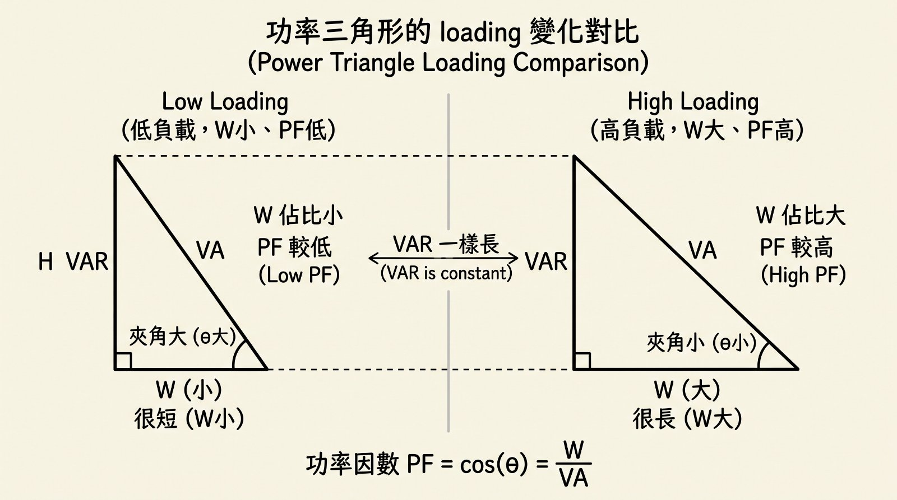

## PFC難題

**Q：** Why PFC Freq. 接近 loading Freq. 時會出現 current overshoot & swinging？

**A：** 因為在 loading ↑ or ↓ 時，bulk cap. 會先放、充電，但在 T_high or T_low 大時 bulk 已完全放、充電，而 PFC 注意到 power 不夠 or 太多時，控制 AC Source in。

但在 PFC 的 freq. 接近 loading 的 freq. 時，PFC 會一直追趕 loading 但追不上，導致 current 往反方向修正，result 就是 overshoot、swinging，甚至 clamped，因而使 iTHD ↑，PF efficient ↓。

## What made iTHD ↑

- PFC freq. closed to loading freq.
- Current wave distortion
- Switching power supplies

## What made PF efficient ↓

- low loading

