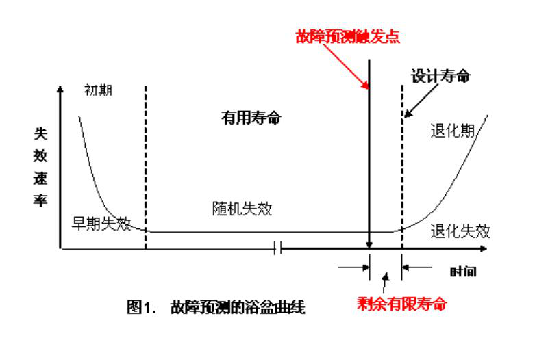

縱軸：失效速率；橫軸：時間 t

| 階段 | 失效型態 | 曲線 |
| --- | --- | --- |
| 初期 | 早期失效 | 失效率高、快速下降 |
| 有用壽命 | 隨機失效 | 低且平穩 |
| 末期 | 退化失效 | 失效率快速上升 |

- **故障預測觸發點**：在退化失效開始前發出預警
- **設計壽命**：退化失效段中的設計目標點
- **剩餘有限壽命**：故障預測觸發點到設計壽命之間的區間

