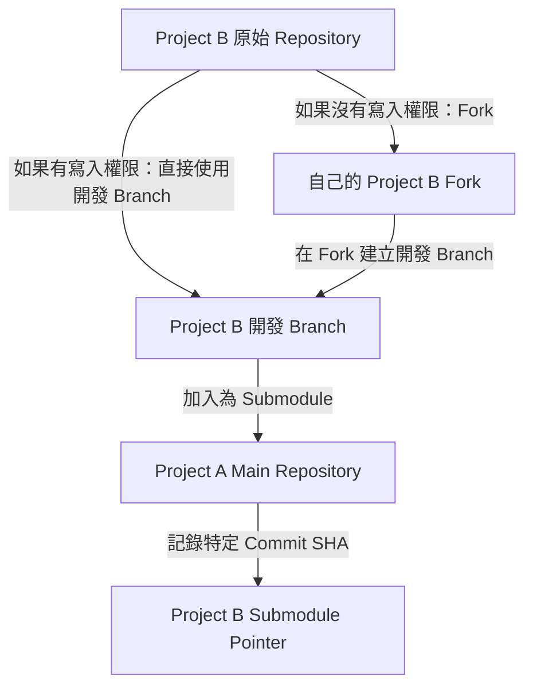
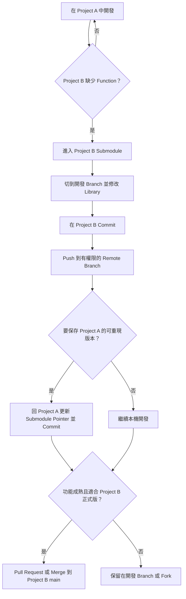
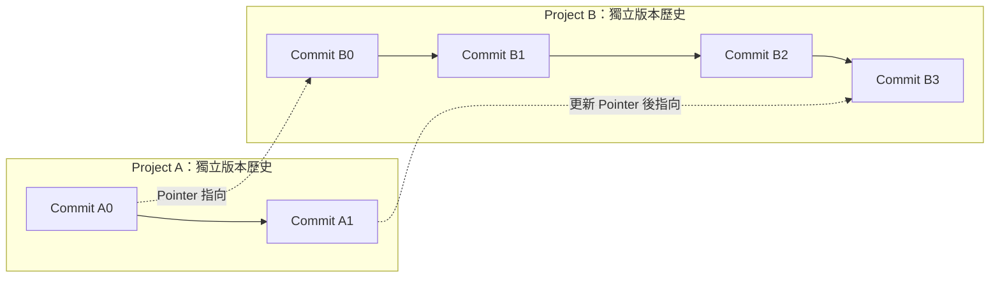

# Git Submodule 開發與同步筆記

> 情境：**Project A** 是自己的研究專案；**Project B** 是 Project A 所依賴的獨立 Library。開發 Project A 時，可能需要直接擴充或修正 Project B 的 Function。

## TL;DR

**可以先在 Project A 內的 Project B Submodule 持續開發，等到適當時機再同步到 Project B 的正式 `main`。**

但是，必須區分三件事：

1. **在 Submodule 中 Commit**：保存 Project B 的程式碼變更。
2. **更新 Project A 的 Submodule Pointer**：讓 Project A 記錄它使用哪個 Project B Commit。
3. **Merge 回 Project B 的 `main`**：讓 Project B 的正式版本採納這些功能。這個動作**不一定需要**做。

注意：在 Submodule 裡 `git commit` 不會自動更新 Project A 的 Pointer；在 Project A 裡 `git commit` 也不會自動把 Submodule 的程式碼 Push 到 Project B Remote。

## 1. Repository 架構

```text
ProjectA/                       # Main Repository
├── train.py
├── evaluate.py
├── configs/
├── .gitmodules
└── external/
    └── ProjectB/               # Submodule：獨立 Git Repository
        ├── backbone.py
        ├── attention.py
        └── utils.py
```



> 若 Project B 本來就是你擁有的 Repository，可以省略 Fork；若是第三方開源專案且你沒有 Push 權限，應先 Fork。

## 2. 日常開發與正式同步是不同的事情



### 什麼時候需要同步？

| 動作 | 何時做 | 一定要做嗎？ |
|---|---|---|
| `Commit` Project B | 每完成一項可獨立追蹤的變更 | 強烈建議 |
| `Push` Project B 開發 Branch | 要備份、跨機器使用、與團隊共享時 | 其他人要取得 Commit 前必須做 |
| 在 Project A `Commit` Submodule Pointer | 重要實驗、Release、要讓同事重現時 | 對可重現版本非常重要 |
| Merge 到 Project B `main` | 功能驗證完成、通用且符合 Project B 的維護需求時 | **不一定** |
| Pull / Merge Project B 上游變更 | 需要上游 Bug Fix、新功能或安全更新時 | 視需求而定 |

## 3. 具體操作

### 3.1 首次加入 Submodule

如果 Project B 是你能直接寫入的 Repository：

```bash
git submodule add <PROJECT_B_REPO_URL> external/ProjectB
git add .gitmodules external/ProjectB
git commit -m "Add Project B submodule"
```

如果需要自己維護第三方程式碼，先建立 Fork，然後把 **Fork URL** 加入 Submodule。

### 3.2 在 Submodule 開發新 Function

```bash
cd ProjectA/external/ProjectB

# 初次開發時，切出 Branch，避免直接在 Detached HEAD 上開發
git switch -c dev/project-a

# 修改 Project B 的程式碼...
git add .
git commit -m "Add function required by Project A"

# 將開發 Branch 推到自己有權限的 Remote
git push -u origin dev/project-a
```

> 此時 Project B 已有新的 Commit，但 Project A 仍記錄舊版 Pointer，直到你在 Project A 對 Submodule 路徑執行 `git add` + `git commit`。

### 3.3 在適當時機固定 Project A 的版本

```bash
# 從 ProjectA/external/ProjectB 回到 ProjectA
cd ../..

git status
# 可能出現：modified: external/ProjectB (new commits)

git add external/ProjectB
git commit -m "Pin Project B with new functions"
git push
```

**順序建議：先 Push Project B 的 Commit，再 Commit / Push Project A 的 Pointer。** 否則其他人可能取得 Project A，卻無法下載它指向的 Project B Commit。

### 3.4 最後才決定是否合併回 Project B 的 `main`

假設 Project B 的 `dev/project-a` 已驗證完成：

```bash
cd ProjectA/external/ProjectB

git switch main
git pull --ff-only origin main
git merge dev/project-a
# 執行測試，確認通過後再推送
git push origin main
```

這組指令僅適用於**你有權限直接維護 Project B 的 `main`**，且團隊允許直接 Merge 的情況。如果是第三方 Project B，通常應從自己的 Fork 發 **Pull Request**，而不是直接 Push 原專案。

> 合併後，Project A 不會自動改指向 Project B `main` 的最新 Commit。是否更新 Project A 的 Pointer，仍由你決定。

## 4. 核心版本關係示意



可以連續在 Project B 產生 `B1 → B2 → B3`，不需要每個 Commit 都立刻更新 Project A。等重要實驗需要保存版本時，Project A 才由 `A0` 更新為 `A1`。

**但要注意：** 只要 Project A 實際已使用 B3 的 Function，卻仍然固定 B0，別人只靠 Project A 的最新 Commit 便無法完整重現你的結果。因此重要實驗前至少更新一次 Pointer。

## 5. 常見問題與陷阱

### Q1：直接把 Library 資料夾複製進 Project A，跟 Submodule 一樣嗎？

不一樣。**單純複製**只會把檔案變成 Project A 自己管理的檔案；**Submodule** 則保留 Project B 獨立 Repository 與 Git History，主專案記錄的是一個 Commit Pointer。

### Q2：Submodule 修改後會立刻影響 Project A 執行嗎？

**會影響本機執行。** 因為 Project A 直接讀取 Submodule 資料夾的實際檔案。只是 Project A 的 Git Commit 還沒有正式記錄新版本。

### Q3：如果我不想把研究專用 Function 放回 Project B `main` 呢？

完全可以。保留在自己的 Fork 或獨立 Branch 即可。只要你要重現的 Commit 可被相關開發者存取，Project A 就能固定使用它。

### Q4：其他人如何 Clone 完整 Project A？

```bash
git clone --recurse-submodules <PROJECT_A_REPO_URL>

# 若已經 Clone 過
git submodule update --init --recursive
```

上述指令會 Checkout **Project A 記錄的 Submodule Commit**，不保證是 Project B `main` 的最新版。

### Q5：為什麼 Submodule 會顯示 Detached HEAD？

因為 Git 通常會按照 Project A 記錄的 SHA Checkout，並非自動切到某個 Branch。若要修改 Project B，先切換到可追蹤的開發 Branch：

```bash
cd external/ProjectB
git switch dev/project-a
# 若尚未建立，才使用：git switch -c dev/project-a
```

## 6. 最推薦的實務原則

1. **Project B 的功能修改，在 Project B 自己的 Branch Commit。**
2. **Project B Commit 先 Push 到有權限的 Remote**，避免 Project A 指向別人拿不到的 Commit。
3. **Project A 的重要實驗、Checkpoint 或 Release 要固定 Submodule Pointer**，確保研究可重現。
4. **不要把「更新 Project A Pointer」與「合併回 Project B main」視為同一件事。**
5. **只有通用且已驗證的功能才考慮合併回 Project B main**；專用實驗程式可以長期保留在獨立 Branch 或 Fork。

### 一句話記憶

> **在 Project A 使用 Project B 的 Submodule 開發時，Project B 可以先獨立演進；Project A 在重要節點固定版本；Project B 的正式 `main` 則等你需要時才合併。**
