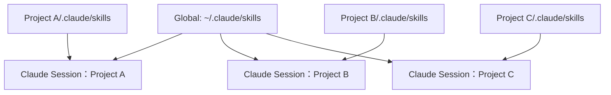
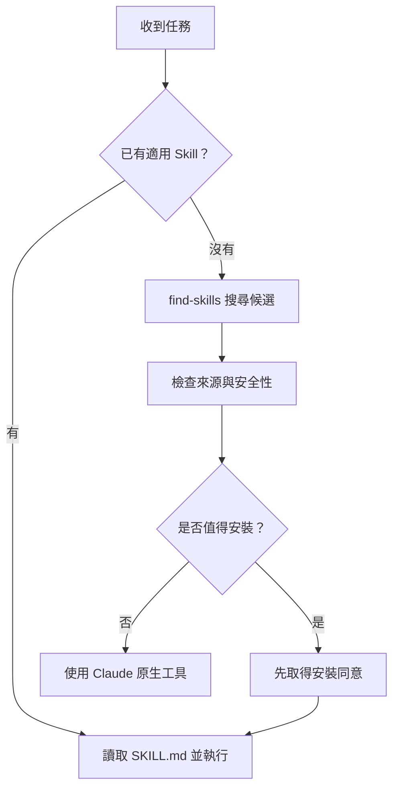

# Claude Code：Global 與 Project Skills 管理及跨電腦移轉筆記

> 適用對象：同一個父資料夾下有多個獨立 Git Repository，想要共用通用 Skills、保留專案特有 Skills，並能在新電腦快速還原設定。
>
> 更新日期：2026-10-13。CLI 指令可能更新，執行前可參閱 [Claude Code Skills 文件](https://code.claude.com/docs/en/skills)、[skills.sh CLI](https://www.skills.sh/docs/cli)。

## 1. 三個概念先分清楚

| 名稱 | 放置位置 | 生效範圍 | 建議放什麼 | 適合納入 Git？ |
|---|---|---|---|---|
| **Global / Personal Skill** | `~/.claude/skills/<name>/SKILL.md` | 此電腦使用者的 Claude Code 專案 | `find-skills`、通用 Debugging、Paper Review | **另開設定 Repo** 備份自製 Skills；不會隨單一 Project Git 自動同步 |
| **Project / Local Skill** | `<project>/.claude/skills/<name>/SKILL.md` | 該 Project | 特定 Dataset 評測、專案測試流程 | **是**，加入該 Project 的 Git |
| **CLAUDE.md** | `~/.claude/CLAUDE.md` / `<project>/CLAUDE.md` | 指示 Claude 如何工作（本身不是 Skill） | 全域行為規則 / 專案背景、規範 | Global 另備份；Project 納入該 Repo |

**關鍵：** `git branch`、Claude Session、Skill Scope 是三回事：
- Git Branch 管理**程式碼版本**；不同功能實作才視情況開 Branch。
- Claude Session 管理**對話上下文**；每個 Project 建議從其根目錄各自啟動。
- Global / Project Skill 管理**可以使用哪些工作流程**；與 Git Branch 不綁定。

## 2. 建議目錄架構

```text
~/.claude/
├── CLAUDE.md                      # 個人全域規則
└── skills/
    ├── find-skills/              # 搜尋新 Skills
    └── paper-review/             # 自製全域 Skill（範例）

~/Research/
├── ProjectA-Deepfake/            # 獨立 Git Repository
│   ├── CLAUDE.md                 # Project A 規則
│   ├── .claude/skills/
│   │   └── deepfake-evaluation/
│   │       └── SKILL.md
│   └── train.py
├── ProjectB-3DGS/                # 獨立 Git Repository
│   ├── CLAUDE.md
│   └── .claude/skills/
│       └── camera-trajectory/
│           └── SKILL.md
└── ProjectC-RAG/                 # 獨立 Git Repository
    ├── CLAUDE.md
    └── .claude/skills/
        └── rag-evaluation/
            └── SKILL.md
```

### Mermaid：載入範圍



> 若將共用 Skills 放在同一父資料夾，載入細節會受到 Git Repository 邊界與 Claude Code 版本影響；跨**獨立** Repo 最穩定的做法是把共用 Skills 放 `~/.claude/skills/`，而不是依賴父資料夾自動載入。

## 3. 在目前電腦安裝（Linux / macOS / WSL）

### 3.1 檢查環境

```bash
claude --version
node --version
npm --version
```

> 需先安裝 Claude Code、Node.js、npm；以下的 `npx` 需要 npm。

### 3.2 建立 Global 設定

```bash
mkdir -p ~/.claude/skills
nano ~/.claude/CLAUDE.md
```

建議全域 `CLAUDE.md`（可複製）：

```markdown
# Global Claude Code Instructions

## Skill Discovery
- For non-trivial tasks, check installed Skills first.
- If none match, use `find-skills` or `npx skills find <keyword>` to search.
- Evaluate source credibility, relevance, and requested permissions.
- Ask for approval before installing third-party Skills.
- Do not repeatedly search for trivial tasks.
- If no suitable Skill exists, use built-in tools.

## Development
- Read the current project's CLAUDE.md before changing code.
- Prefer minimal changes and run relevant tests.
- Report file changes, validations, and unresolved risks.
```

### 3.3 安裝全域 find-skills

```bash
npx skills add vercel-labs/skills --skill find-skills -g -a claude-code
```

搜尋與檢查：

```bash
npx skills find pytorch
npx skills ls -g
ls -la ~/.claude/skills
```

> `npx skills` CLI 可透過 `find`、`list`、`add`、`update` 管理 Skills；不同版本的互動提示可能不同。

## 4. 建立每個 Project 的專用設定

以 Project A 為例：

```bash
cd ~/Research/ProjectA-Deepfake
mkdir -p .claude/skills/deepfake-evaluation
nano CLAUDE.md
nano .claude/skills/deepfake-evaluation/SKILL.md
```

Project `CLAUDE.md`（範例）：

```markdown
# Project A — Deepfake Detection
- Framework: Python / PyTorch.
- Keep dataset splits and evaluation protocols consistent.
- Do not silently change random seeds or hyperparameters.
- Treat third_party submodules as independent Git repositories.
- Use deepfake-evaluation Skill when preparing dataset evaluations.
```

Project Skill `SKILL.md`（範例）：

```markdown
---
name: deepfake-evaluation
description: Evaluate face forgery detection experiments, including dataset splits, metrics and cross-dataset generalization.
---

# Deepfake Evaluation
1. Verify real/fake labels, train/test splits and preprocessing.
2. Record backbone, checkpoints, and inference settings.
3. Calculate agreed metrics consistently.
4. Report per-dataset results and limitations.
5. Never fabricate scores or alter splits silently.
```

**納入 Project A 自己的 Git：**

```bash
git add CLAUDE.md .claude/skills/deepfake-evaluation/SKILL.md
git commit -m "Add project Claude instructions and evaluation skill"
git push
```

> `git push` 需要你已設定 Git Remote 與可推送 Branch。Project B/C 照同樣方式各自建立並 Commit。**不要把它們當成 Project A 的 Submodule**，除非它們原本就是共享程式庫。

### Mermaid：執行任務時如何選 Skill



## 5. 日常怎麼用 Claude CLI

**Project A：**

```bash
cd ~/Research/ProjectA-Deepfake
claude
```

**Project B：** 開新 Terminal（或結束上一個 Session）

```bash
cd ~/Research/ProjectB-3DGS
claude
```

原則：一個 Project 一個主要 Session。不同的 Git Branch 只有在你要隔離新功能、Bug Fix、實驗版本時才建立：

```bash
git switch -c feature/new-loss
claude
```

如果要在同一 Repo 同時做兩個互不干擾的任務，可考慮 Git Worktree，而不是讓兩個 Claude Session 同時改同一份 Working Tree。

## 6. 其他電腦重裝：最重要的跨電腦觀念

**Project Skills 很容易搬：** 只要將 `.claude/skills/` 與 `CLAUDE.md` Commit 到專案 Git，新電腦 `git clone` 就會一起取得。

**Global Skills 不會跟著 Project A 的 Git 一起搬：** `~/.claude/` 在使用者 Home Directory 之下；新電腦需要重新安裝，或另外備份個人的自製 Skills。

### 6.1 新電腦：基本還原指令（Linux / macOS / WSL）

```bash
# 1. 確認前置環境（若沒有請先安裝）
claude --version
node --version
npm --version

# 2. 重建 Global Skills 基本目錄
mkdir -p ~/.claude/skills

# 3. 安裝 Global find-skills
npx skills add vercel-labs/skills --skill find-skills -g -a claude-code

# 4. Clone 自己的各個專案（替換成真實網址）
mkdir -p ~/Research
cd ~/Research
git clone <PROJECT_A_GIT_URL> ProjectA-Deepfake
git clone <PROJECT_B_GIT_URL> ProjectB-3DGS

# 5. 如果專案有 Git Submodule，再初始化
cd ProjectA-Deepfake
git submodule update --init --recursive

# 6. 啟動 Claude
claude
```

**以上還沒還原全域 `CLAUDE.md` 或自己寫的 Global Skills**；建議使用下面的個人設定 Repository。

### 6.2 推薦：另外建立私人 `claude-config` Repository

**原電腦建立備份（Linux / macOS / WSL）：**

```bash
mkdir -p ~/claude-config/global-skills
cp ~/.claude/CLAUDE.md ~/claude-config/CLAUDE.md
# 僅備份自己撰寫／已審核、可合法分發的 Skills：
cp -R ~/.claude/skills/paper-review ~/claude-config/global-skills/  # 如果存在
cd ~/claude-config
git init
printf '%s\n' '.env' '*.key' '*.pem' 'credentials*' 'settings.local.json' >> .gitignore
git add CLAUDE.md global-skills .gitignore
git commit -m "Backup personal Claude instructions and skills"
# 在 GitHub 等平台先建立 Private Repo 後：
git remote add origin <PRIVATE_CONFIG_REPO_URL>
git branch -M main
git push -u origin main
```

> 不建議直接對整個 `~/.claude/` 執行 `git add -A`：它可能含有憑證、登入狀態、對話紀錄、本機路徑與私人設定。只備份已檢查過的檔案。

**新電腦還原：**

```bash
cd ~
git clone <PRIVATE_CONFIG_REPO_URL> claude-config
mkdir -p ~/.claude/skills
cp ~/claude-config/CLAUDE.md ~/.claude/CLAUDE.md
# 若有自製 Global Skills：
cp -R ~/claude-config/global-skills/. ~/.claude/skills/
# 第三方 find-skills 使用官方 CLI 重新安裝
npx skills add vercel-labs/skills --skill find-skills -g -a claude-code
```

> 當 `~/claude-config/global-skills/` 為空時，`cp -R` 不會複製任何 Skill；可略過。若使用 Symbolic Links 管理 Skills，則應改用實際檔案備份或明確的重新安裝清單。

### 6.3 Windows PowerShell 對應指令

```powershell
# 確認環境
claude --version
node --version
npm --version

# Global 目錄與 find-skills
New-Item -ItemType Directory -Force "$HOME\.claude\skills"
npx skills add vercel-labs/skills --skill find-skills -g -a claude-code

# 新增 / 編輯全域 CLAUDE.md
notepad "$HOME\.claude\CLAUDE.md"

# Clone 專案
New-Item -ItemType Directory -Force "$HOME\Research"
Set-Location "$HOME\Research"
git clone <PROJECT_A_GIT_URL> ProjectA-Deepfake
Set-Location ProjectA-Deepfake
git submodule update --init --recursive
claude
```

**注意：** Windows 原生 PowerShell 的 `$HOME` 和 WSL 的 `~` 是不同位置。若主要在 WSL 跑 Claude Code，請在 WSL Linux 環境中安裝與還原，不要混用兩套 `~/.claude`。

## 7. Skills 更新、查詢與安全檢查

```bash
# 搜尋
npx skills find "pytorch profiling"

# 顯示已安裝 Skills
npx skills list
npx skills ls -g

# 更新已安裝 Global Skills（更新前先檢查影響）
npx skills update -g

# 顯示 Claude Code 版本
claude --version
```

安全原則：
1. 新增第三方 Skill 前查看 `SKILL.md`、相關 Script 與權限需求。
2. 不要將 API Keys、Tokens、`.env`、Claude 登入狀態提交到 Git。
3. 自製 Project Skill 與專案程式碼一起 Commit，利於團隊協作與研究重現。
4. 重要實驗應額外記錄 Git Commit、Submodule Commit、Dataset/Model 版本與 Python Dependencies。
5. Marketplace Plugins 與獨立 `SKILL.md` Skills 不完全一樣；若有使用 Marketplace Plugin，應另外保存其名稱和安裝指令。

## 8. 快速決策表

| 問題 | 建議 |
|---|---|
| 這個 Skill 多個 Repo 都會用嗎？ | 放 Global `~/.claude/skills/` |
| 只適用一個 Project 的實驗流程？ | 放 `<project>/.claude/skills/` |
| 這是「Claude 應遵守的規則」而不是重複任務流程？ | 寫 `CLAUDE.md` |
| 換電腦後想直接用 Project Skills？ | 將 `.claude/skills/` Commit 到 Project Git |
| 換電腦後想找回 Global 自製 Skills？ | 使用私人 `claude-config` Git Repo |
| 要安裝第三方 Skills？ | 優先保存來源與安裝指令；新電腦重新安裝 |
| 每個 Project 都要開 Git Branch 嗎？ | 不用；僅在隔離程式碼變更時建立 |
| 可以從父資料夾開一個 Claude Session 同時修改所有 Repo 嗎？ | 技術上可行，但平常建議分開 Session，降低操作錯誤 |

## 9. 一分鐘複習

> **Global = 我這個使用者在各專案都能用的 Skills。**  
> **Project / Local = 該 Git Project 專用的 Skills。**  
> **CLAUDE.md = 開發規則與背景，不等於 Skill。**  
> **Project Skills 跟 Project Git 一起搬；Global Skills 用私人設定 Repo 備份，或用安裝指令重建。**

### 官方參考

- [Claude Code Skills](https://code.claude.com/docs/en/skills)
- [Anthropic Agent Skills Overview](https://platform.claude.com/docs/en/agents-and-tools/agent-skills/overview)
- [skills.sh CLI Documentation](https://www.skills.sh/docs/cli)
- [find-skills](https://www.skills.sh/vercel-labs/skills/find-skills)
