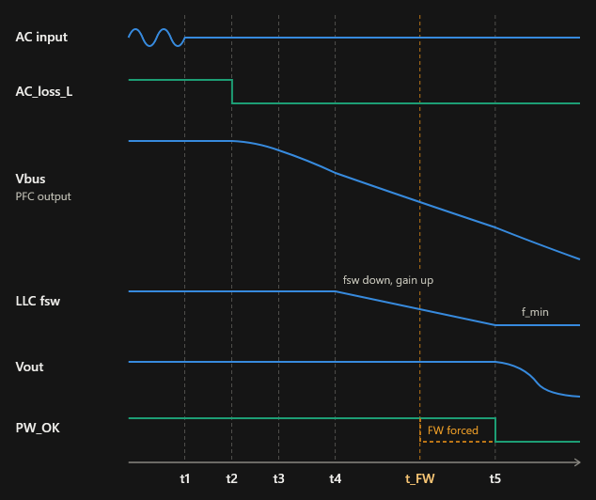
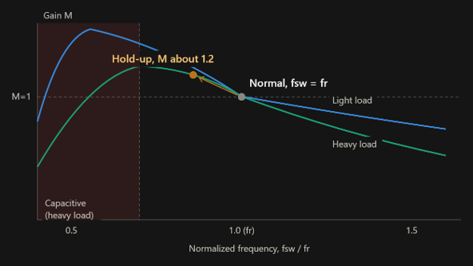
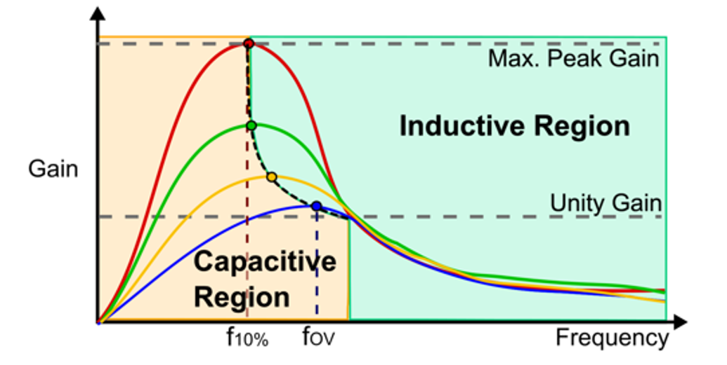
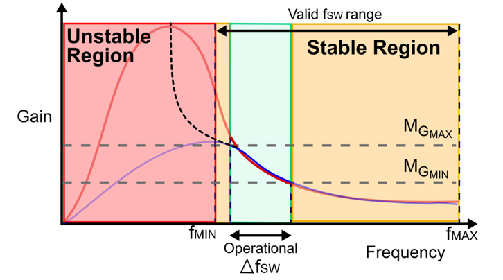

### Definition of Hold-up time
- The time a power supply can keep its output voltage within regulation after the AC input is lost, using only energy stored in its bulk capacitors.

---

### Hold-up Time Process

- t1: The AC input is lost, but the PFC and Vbus carry on for a few duty cycles.
- t2: Vbus starts to fall and AC_loss_L goes low.
- t3: Cbus supplies the load and Vbus decays slowly.
- t4: Cbulk supplies the load and the LLC lowers its switching frequency. The lower frequency raises the LLC gain, which keeps Vout regulated from a falling Vbus.
- t5: The LLC reaches its minimum frequency and can no longer raise the gain, so PW_OK goes low and Vout drops.
- t_FW (amber): In practice the firmware ends hold-up at about 20 ms under heavy load, before the LLC reaches its limit.

---

### How does the LLC keep Vout stable when Vbus drops?

- Idea: the LLC has a “gain knob”, and the knob is frequency.
Higher frequency gives lower gain; lower frequency gives higher gain.
- Normal: Vbus is 400 V, and the LLC runs at its resonant point (gain ≈ 1).
- AC lost: Vbus starts falling, so the LLC lowers its frequency to raise the gain.
- Result: Vbus goes down, but Vout stays flat.

---

### Why firmware cuts off early

- The main cause is probably capacitive-mode operation of the LLC.
- Capacitive mode (main cause): 
  - As the frequency is pushed down toward the gain peak, which is below the resonant frequency, the resonant current starts to lead the voltage.
  - Heavy load makes this worse, because the gain peak moves to a higher frequency and gets lower. The capacitive boundary can therefore be reached before the programmed minimum frequency.

